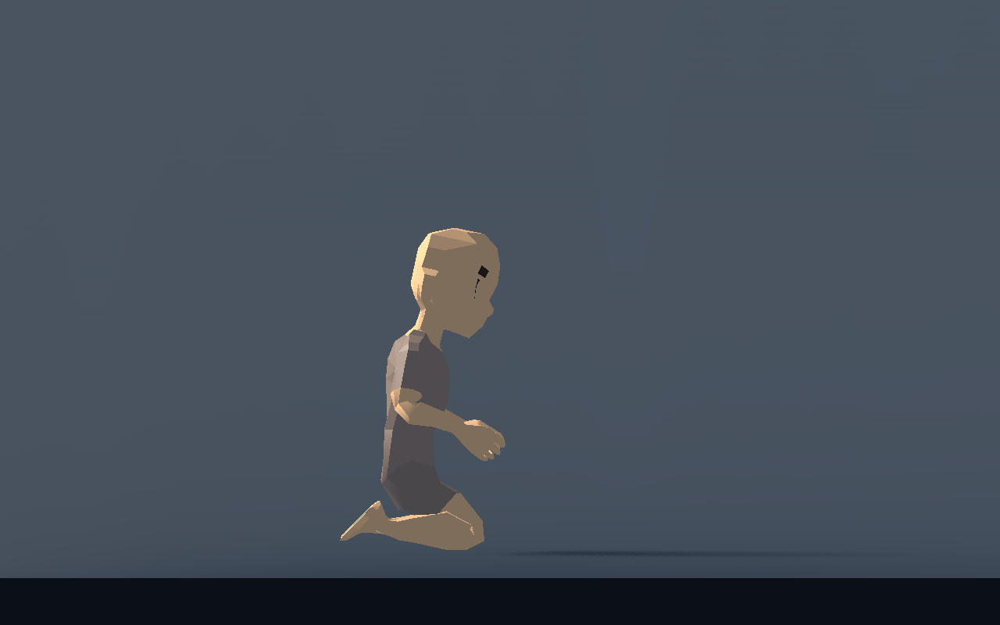

# T-011 — Lager zitten op de kuiten bij sliden

Vervolg op de gebruikersfeedback bij c041f65e. De heuphouding wordt berekend uit de gemeten scheen-/bovenbeenlengte en de bestaande kniehoogtemarge. Zo kan het bekken verder achterwaarts en lager naar de kuiten zonder de enkeldoelen of capsule te verplaatsen. Borstvooroverstand, slidevaart, duur en invoer blijven gelijk.

**Editor:** het bestaande Body Profile heeft `Slide Sit Degrees`, standaard55 graden, bereik25–70. Groter zit lager. De daadwerkelijke houding begrenst zichzelf onder de bestaande maximale kniebuiging. De waarde werkt live, behoort tot het eigen profiel en bouwt het model niet opnieuw op. `Slide Knee Clearance Ratio` blijft de marge voor zichtbare kniedikte.

## Technisch gecontroleerd

Gerichte stijl- en integratiesuites PASS, Godot4.7.2, echte Characters. De oude eis dat de heup minstens70% bovenbeenlengte boven de knie moest staan is vervangen door de gevraagde lagere zit. Default en live25/55/70 zijn op vier lichaamsverhoudingen gecontroleerd: grootste echte enkelfout0,00000073 m, grootste kniebuiging152,61 graden tegenover de bestaande155-gradenlimiet. De knieën blijven boven de vloer. [Uitvoer](deep-slide-validation.txt) en [gewrichtposities](deep-slide-metrics.json).

Artemis: heuphoogte0,345→0,246 m, heup achterwaarts0,132→0,247 m; de knieën blijven op circa0,053 m. De echte D3D12/Forward+-renderer op RTX5060Ti controleerde alle3110 huidvertices: minimum11,87 mm boven de wereldvloer. Dit is een gerichte pose-/huidcontrole, geen nieuwe prestatiemeting.

Dezelfde renderer controleerde de losse grotere bijstappen en direct starten met lopen. De verschillende voetrichtingen blijven zichtbaar na rust; de vrije voet heft afzonderlijk zonder zichtbaar kruisen. [Rust na90 graden](quiet-turn-images/turn90_rest.png), [volgende grotere stap](quiet-turn-images/turn180_step.png), [negen frames lopen na draai](quiet-turn-images/turn_walk9.png). Het tijdelijke reproduceerscript en extra front-/vierlichamenbeelden blijven lokaal in de taakvisualisatie `t011-quiet-turn-slide`.

## Menselijke beoordeling en volgende stap

De gevraagde diepere zithouding is gebouwd en in echte beelden gecontroleerd. De concrete bewegende combinatie met WALK en SIDEDIAG blijft ter beoordeling door de gebruiker. Root combineert deze afzonderlijke posewijziging met de andere gecontroleerde correcties en verzorgt de gedeelde speelproef.
