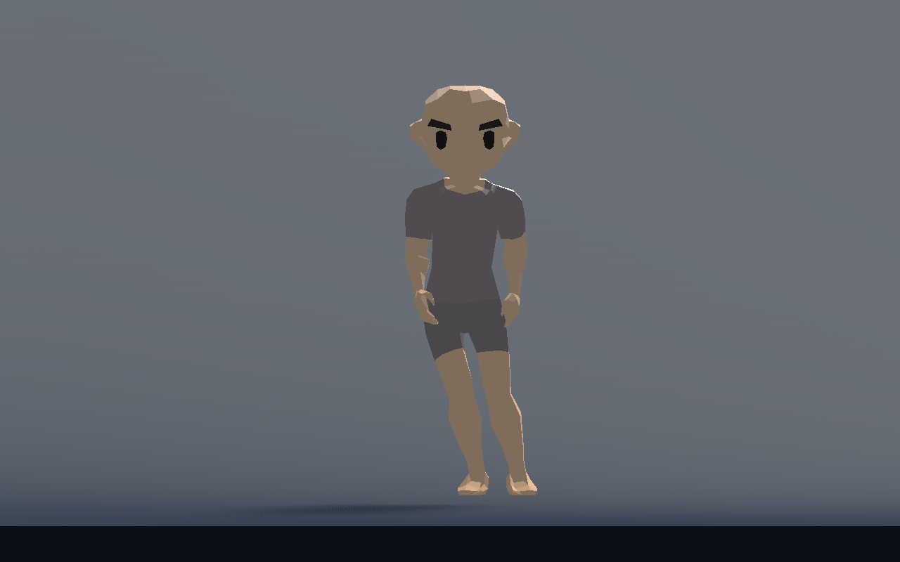
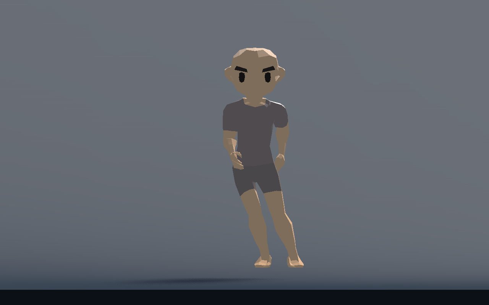
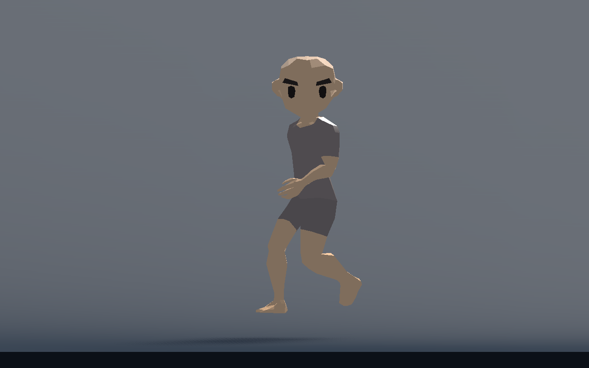
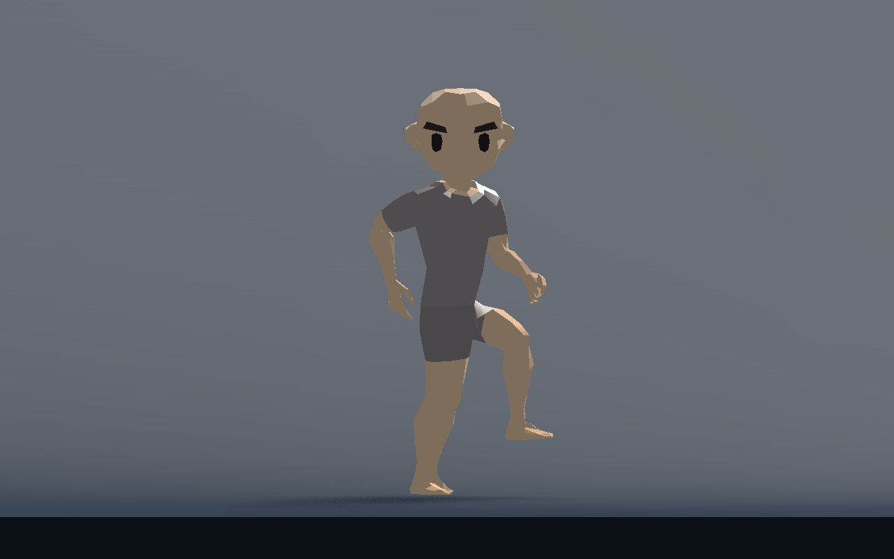

# T-011 — zijwaartse hup en diagonale bewegingsas

Vervolg op `c041f65e`. De gebruiker vraagt een kleine echte zijwaartse sprong, groter bij sprint, en diagonaal dezelfde gang onder de bewegingshoek. De afzonderlijke helper staat in `798f04d`; presentatie en gerichte proef in `225ab33`.

## Gebouwd

`AtlasGaitStyle.side_amount(local_velocity)` classificeert alleen snelheid in motorruimte. Binnen 20° rond zuiver zijwaarts is de zijstijl volledig actief, tussen 20° en 30° wordt gemengd. De gedeelde motor/presentatiekeuze gebruikt `side_amount > 0.5`. De helper kent geen input, IK of contactsysteem.

SIDE gebruikt de al bestaande echte capsulevlucht. Beide voeten trekken samen bescheiden in en landen op twee lokaal gemeten contactpunten. De steunpunten blijven wereldvast en tijdens vlucht zijn beide locks vrij. `Side Hop Tuck Ratio` is via het lichaamsprofiel instelbaar en groeit mee met snelheid. Onder een blokkerend plafond of bij nulhoogte blijven afwisselende werkelijk gesteunde stappen beschikbaar. Er is geen afzonderlijke hoptimer, extra impuls of nieuwe solver.

`diagonal_yaw(local_velocity, motion_profile)` levert de nabije lengte-as voor lopen, sprint en Alt-wandelen. Voor W+D is de visuele as −45°, voor S+D +45°; achterwaarts beweegt het Character achteruit langs die as. Bekken, kniepoles, armdoelen en voetgrondbasis gebruiken dezelfde visuele oriëntatie. De hoofdblik en capsuleyaw blijven behouden. Vrije voetankers worden bij het draaien van de as omgerekend, zodat hun bereikte plaats behouden blijft. Exact voorwaarts heeft een nulhoek. Sprint gebruikt de volledige renstijl, ook wanneer de toegestane zij-/diagonale snelheid lager is dan voorwaarts.

Een sprintomkering bij SIDE maakte met twee vaste voeten de gewone steunperiode te lang. De bestaande motorplanner kent al korte start-/omkeersteun; de integratie past die ook bij SIDE-sprint toe. De twee lokaal geteste Character-regels zijn bewust buiten de presentatiecommit gebleven, omdat root ze met de Alt-motorwijziging integreert:

```gdscript
var side_stride := AtlasGaitStyle.side_amount(global_basis.inverse() * Vector3(velocity.x, 0.0, velocity.z)) > 0.5
var first_support_ratio := 1.0 if _sprint_requested and not side_stride else body_profile.walk_start_support_ratio
```

## Technisch gecontroleerd

Godot 4.7.2, physics60. De gerichte proef gebruikt vier echte lichaamsverhoudingen, JOG en SPRINT, beide zijrichtingen en alle vier diagonalen: 48 starts. Daarna stopt iedere route, en een doorgaande sprintreeks wisselt tussen zijwaarts, voor-/achterdiagonaal, omgekeerd zijwaarts en vooruit. Met bovenstaande motorvoorwaarde slagen alle bereik-, contact-, richting- en hoofdasserties.

- Maximale werkelijke enkel-doelfout: **1,661 mm**; geplante enkelerror maximaal **0,000644 mm**.
- Gemeten drift van vaste wereldcontacten: **0**; geen bereiknoodloslatingen.
- Kleinste links/rechts-afstand in de zichtbare lichaamsbasis: **8,81 cm**.
- Maximaal **2 voetstralen per physics-tick**; capsuleyaw onveranderd en hoofdhoekfout kleiner dan 0,000001 rad.
- Artemis SIDE-JOG: echte capsuleboog **2,66 cm**, lokale voetintrek maximaal **2,36 cm**. SIDE-SPRINT: boog **6,01 cm**, intrek **3,41 cm**. De hogere vlucht komt uit dezelfde motorcurve.

De bestaande presentatiecomponent- en kniecontrole slagen eveneens. Headless `--fixed-fps 60` wordt alleen gebruikt om logische proeven te versnellen; dit is geen nieuwe prestatiemeting. Behoud van de volledige voorwaartse RUN-referentie en de combinatie met de nieuwe Alt-/JOG-stijlen worden bij rootintegratie gecontroleerd.

[Compacte metingen](direction-style-metrics.json) en [controle-uitvoer](direction-style-validation.txt). De uitgebreide actuele proefdata staan lokaal in `user://t011_direction_style_metrics.json`.

## Werkelijke beelden

D3D12 Forward+, echte Artemis-motorframes. De gewone JOG-/armstijl in deze beelden is de bronbasis vóór de afzonderlijke WALK/JOG-verfijning van root.









Herhalen na de motorintegratie: `godot --headless --path game --script res://tests/procedural_direction_style_checks.gd --fixed-fps 60`. Beelden: `godot --path game --script res://tests/procedural_direction_style_preview.gd`.

## Beoordeling en volgende stap

Het team heeft deze beelden gecontroleerd. De gebruiker beoordeelt de gecombineerde proef in volgorde WALK, SIDE, DIAGONAAL, SLIDE en IDLE. Deze deelproef is geen menselijke acceptatie van de gehele beweging. Root integreert de motorvoorwaarde, de nieuwe ontspannen Alt-wandeling en JOG, plus afzonderlijke draai-/slide-/idlecorrecties, en publiceert daarna het geschikte speelcheckpoint.
