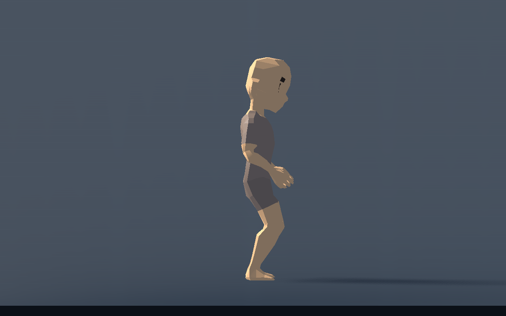
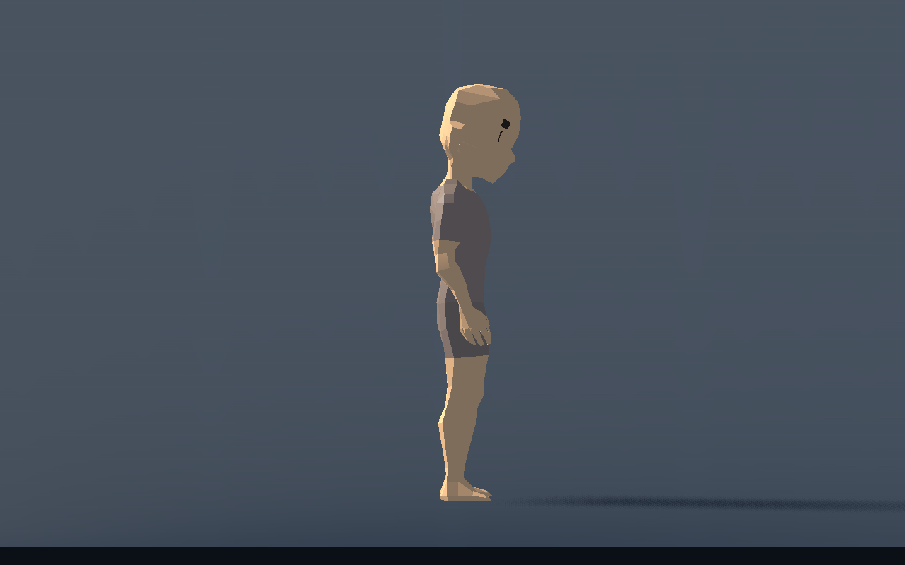

# T-011 — zachte voetopvang

Afzonderlijk checkpoint na `5f1923b`, naar aanleiding van de feedback dat de beweging beter maar nog houterig oogt en bij landingen moet meegeven. De eerdere [zijposes](live-visual.md) en [voor-/achterproef](live-front-back.md) blijven behouden.

## Gebouwd

Een kleine kritisch gedempte presentatieveer verlaagt het bekken na een echt voetcontact. De bestaande IK laat de knieën daardoor meebuigen terwijl de steunvoet op zijn wereldpunt blijft. Een normale pas gebruikt 2,5% van beenlengte; de impactsnelheid van een bewuste sprong/val schaalt de grotere opvang tot 12%. De piek volgt circa 55 ms na het contact. De veer dooft zonder extra opwaartse kapselbeweging uit; nieuwe snelle contacten stapelen niet onbeperkt op.

Het profiel bevat `Step Compression Ratio`, `Landing Compression Ratio` en `Compression Peak Time`, elk met Nederlandse uitleg en direct per Character instelbaar. Nul schakelt het betreffende accent uit. Lage houdingen resetten de veer. Contacten blijven afkomstig van de motoruitkomst en daadwerkelijk geplante voeten; er komt geen aparte voorspeller, grondquery, geluid of zware landingscue bij.

De lange stopproef vond ook een bestaand bereiktekort: na uitrollen kon de achterste vastgeplante voet van het gemiddelde testlichaam 5,15 cm boven zijn doel blijven, doordat de benodigde bekkenverlaging op 36% beenlengte werd afgekapt. Alleen die bovengrens is 50% geworden. De correctie wordt uitsluitend gebruikt als de echte beengeometrie dat vereist; het contact schuift niet.

## Technisch gecontroleerd

Vier echte Characters met verschillende boven-/onderbeenverhoudingen lopen tien seconden, rollen uit, springen, landen en nemen vervolgens gesteunde passen met nul-vluchtcurve. De nieuwe `procedural_compression_checks.gd` controleert één veerimpuls per werkelijk contact, uitdempen, reset, bereik en het voorkomen van cumulatief inzakken. Een vijfde Artemis met uitgeschakelde veer volgt dezelfde capsulebaan: grootste gemeten verschil 0,000000237 m.

Gewone paspieken: 1,62–1,96 cm. Spronglanding: 8,05–9,68 cm, naar verhouding van het lichaam. Gesteunde snelle passen: 1,49–1,80 cm. Alle contact-/bereikchecks, de bestaande knie-, integratie- en presentatiecomponenttests slagen. De camera-uitslag en het raybudget blijven gelijk.

De echte skin-readback verandert op 98/98 renderparen binnen dezelfde physics-tick bij 144 Hz; ook de volledige reeksen bij 60 en 144 Hz veranderen op 179/179 paren. Renderinterpolatie blijft dus actief na de veerwijziging.

De actuele meting gebruikt **Windows, D3D12/Forward+, RTX 5060 Ti**, physics60, VSync uit, geen fixed-fps, 3 s opwarmtijd en 4 s echte meettijd per hoeveelheid. Dit wijkt van de eerdere OpenGL-route af en is geen directe prestatievergelijking. Renderinterval p50/p95/max in ms:

| Characters | p50 | p95 | max | Physics-monitor p95 |
|---|---:|---:|---:|---:|
| 1 | 0,564 | 1,003 | 2,454 | 0,797 |
| 4 | 1,015 | 2,267 | 4,229 | 3,040 |
| 12 | 2,234 | 5,823 | 8,877 | 5,587 |

De physics-monitor geeft laagfrequente snapshots, geen afzonderlijke per-frame CPU-tijden. Grondqueries blijven circa 167/669/2006 per seconde. Dit is een korte meetvloerproef, geen volledige-gamegarantie.

Ruw bewijs: [contactveer](compression-metrics.json), [knieën](compression-knee-metrics.json), [renderkosten](compression-performance.json), [skininterpolatie](compression-interpolation.json), [testuitvoer](compression-validation.txt).

## Beelden en menselijke proef

De [eerste contacttick](compression-images/contact.png) kan door de gebruikelijke renderinterpolatie nog tussen lucht- en steunpose staan. De beelden komen uit echte motorframes. Herhalen: `godot --path game --script res://tests/procedural_compression_preview.gd`; de vier technische suites draaien met `--headless`. De huidcontrole en `procedural_live_preview.gd` vereisen de renderer.

In de speelbare proef: normaal bewegen, sprinten, stoppen en een gewone sprong maken. Let op korte knieopvang zonder voetglijden of een extra sprong van de besturing. Technisch gecontroleerd en door het team bekeken; nieuwe gebruikersacceptatie blijft open. De apart gevraagde rustigere WALK-stijl en bekken-/borstrol volgen in een volgend checkpoint.
