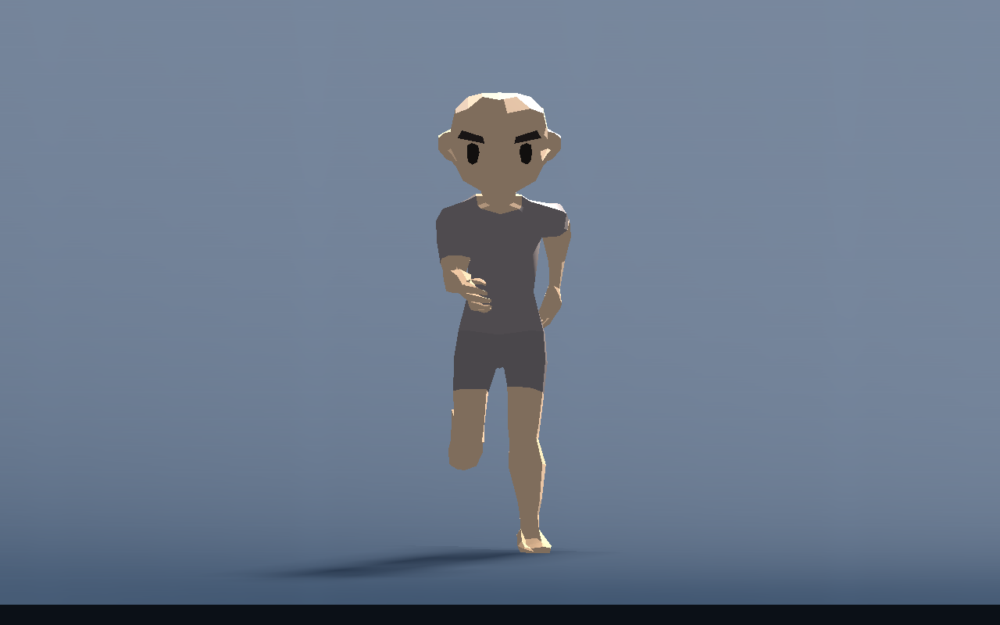
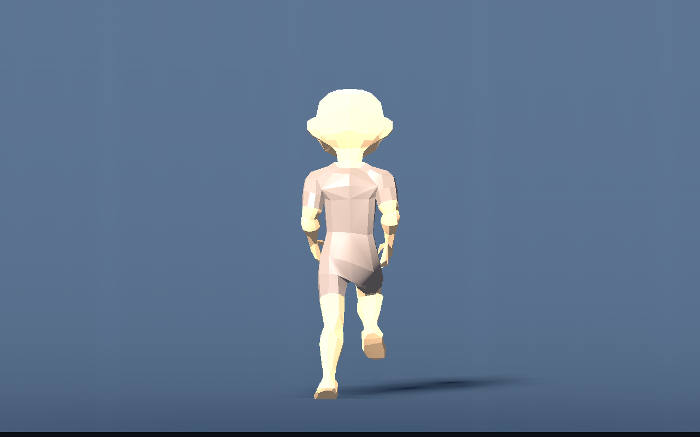

# T-011 — voor-/achteraanzicht na tweede loopreferentie

Afzonderlijke vervolgproef op `9093bc8`. De [eerste visuele validatie](live-visual.md) en bijbehorende beelden zijn behouden. De gebruiker vroeg de nieuwe referentie met voor-/achteraanzichten te bestuderen; de beperkte toepassing hieronder is binnen de reeds bevestigde loopstijl uitgevoerd. De bronreferenties staan bij `source_assets/characters/references`.

## Gebouwd

- De voetsporen worden bij sprint geleidelijk **65% van rustbreedte**. Een al geplante voet schuift niet mee: de eerstvolgende echte voetplaatsing neemt de nieuwe breedte over. Artemis gaat van circa 0,356 naar 0,232 m tussen de enkeldoelen; de drie eenvoudige verhoudingen van 0,230 naar 0,150 m. Ze kruisen de middellijn niet.
- Alleen de voorwaarts zwaaiende hand komt iets naar binnen, tot 20% van de gemeten armlengte. De teruggaande arm behoudt ruimte langs de romp. Voorwaartse handbias en anatomische enkelgrenzen uit het vorige checkpoint blijven behouden.
- Bekken en schouders draaien maximaal **4° tegengesteld** bij sprint. De IK berekent voetbereik vanuit de daadwerkelijk gedraaide heupen; de capsule draait hier niet door. Het hoofd compenseert de rompdraai en houdt de besturingsblik.

De drie instellingen `Running Stance Ratio`, `Arm Inward Ratio` en `Body Twist Degrees` staan in hetzelfde lichaamsprofiel, met Nederlandse uitleg. Ze zijn individueel instelbaar en herbouwen geen rig. Opzettelijke sprong/val en lage houdingen krijgen geen staande romptwist.

## Echte motorbeelden

[Zijpose 1](front-back-images/artemis_side_0.png) en [zijpose 2](front-back-images/artemis_side_3.png) tonen dat de eerder gecorrigeerde knie-/enkelstijl behouden blijft. Alle beelden gebruiken de echte Character-motor; ze zijn geen framehandmatig ingestelde poses.

## Technisch gecontroleerd

- Echte motorregressie op vier lichaamsverhoudingen en 1/5/9 m/s: PASS. Nieuwe checks controleren dat voeten niet kruisen en de hoofdblik bij elke pasfase blijft kloppen. Kleinste voetafstand bij sprint is 0,150 m; grootste hoofd-yawfout onder 0,000001 rad. Geen landingssprong van de losse voet.
- Grootste ongeclampte doelafwijking ongeveer 0,0000012 m. Knieën blijven vooruit buigen, armen in tegenfase en vrije enkels binnen 20° teenhef/45° strekking tegenover het onderbeen.
- Integratie- en presentatiecomponenttests: PASS. Werkelijk geplante enkelafwijking onder een micrometer; geen bereikloslating tijdens normale sprint. Beide gesteunde routes (nul-vluchtcurve en plafond) behouden 26 echte voetcontacten in hun test.
- Echte huid-readback: 104/104 renderparen binnen dezelfde physics-tick veranderen bij 144 Hz; 179/179 over de complete reeks, ook bij 60 Hz. Dus geen terugval naar slechts 60 posebeelden per seconde.

Dezelfde renderfixture als eerder is opnieuw gemeten, na de romptwist en extra armcorrectie. Windows/OpenGL, RTX 5060 Ti, 3 s opwarmtijd, 4 s echte wandtijd, VSync uit, geen fixed-fps. Definitieve renderinterval p50/p95/max in ms: **1 Character 0,553/0,854/1,701; 4 Characters 1,031/2,241/3,728; 12 Characters 2,409/5,890/8,878**. Physics-monitor p95 respectievelijk 0,789/2,129/4,512 ms. Het raybudget blijft gelijk: circa 167/669/2006 queries per seconde. Dit is een korte proef op de eenvoudige meetvloer, geen volledige-gamegarantie; de beperkingen en de eerdere desktopuitbijter staan in het eerste verslag.

Ruw bewijs: [motor/jointmetingen](front-back-knee-metrics.json), [rendermeting](front-back-performance.json), [skininterpolatie](front-back-interpolation.json), [testuitvoer](front-back-validation.txt). Herhalen met dezelfde scripts en commando's uit het eerste verslag.

## Beoordeling en volgende stap

De voor-/achterbeelden zijn technisch en visueel gecontroleerd door het uitvoerende team. Nieuwe positieve gebruikersacceptatie is nog niet gegeven. De volgende menselijke proef beoordeelt de gecombineerde beweging in de hoofdscene; verdere stijlwijzigingen volgen gerichte feedback, niet een onbeperkte extra polishronde.
