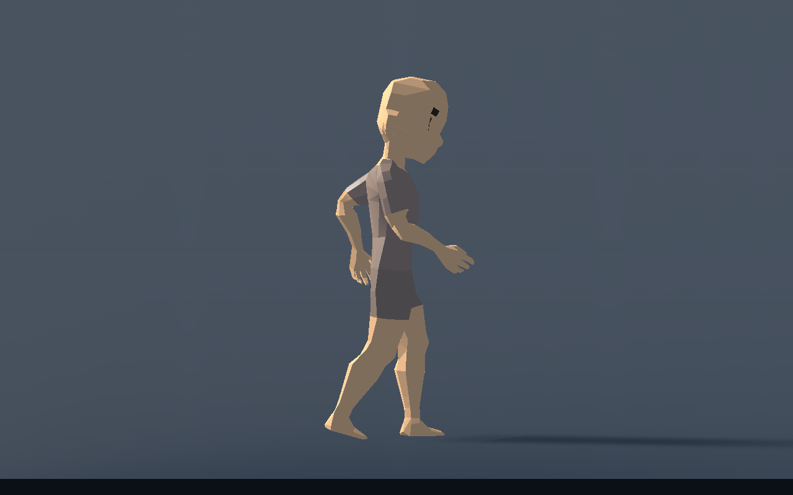
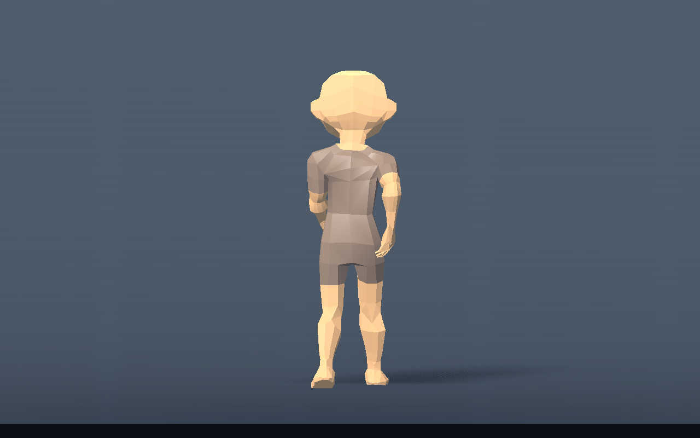
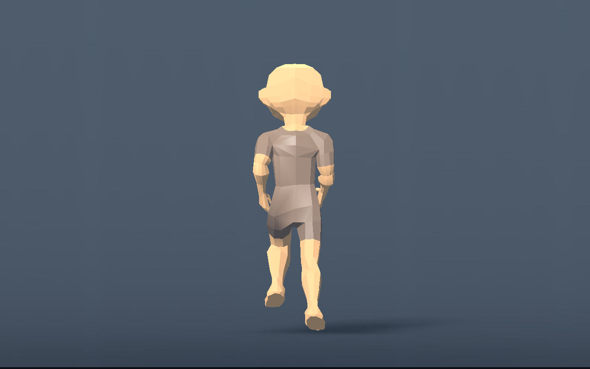
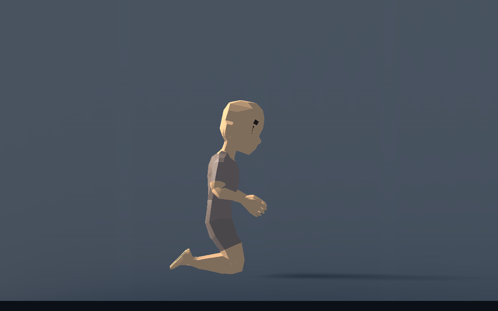

# T-011 — rustig lopen, romptegenbeweging en knieslide

Afzonderlijk stijlcheckpoint na de [zachte contactveer](live-compression.md), bronbasis `4803680`. De gebruiker gaf achteraanzicht- en hoogtevergelijkingen van lopen/rennen, vroeg expliciet om tegengestelde borst-/bekkendraai tijdens rennen, en om sliden op de knieën. De laatste correctie vraagt iets achterover zitten richting kuiten met de borst voorover. Dit checkpoint verandert uitsluitend de zichtbare pose en profielinstellingen.

## Gebouwd

Rustig lopen krijgt **75% van de rustvoetbreedte**, lage voetheffing en beperkt hielherstel. Bij sprint blijft het spoor 65%. Deze overgang verandert alleen nieuwe voetplaatsingen; bestaande steunpunten blijven vast. Bij de normale 5 m/s meet Artemis circa 5,1 cm maximale lokale voetheffing, tegenover 37,0 cm bij 9 m/s sprint. Kniebuiging bij 5 m/s loopt nu ongeveer van 16° tot 64°, tegenover circa 88° maximale buiging in de vorige stijl. De motor blijft de echte pasvlucht bepalen; er komt geen tweede hoogtegolf bij.

Bij lopen rollen bekken en borst licht tegengesteld, met een kleine zijwaartse gewichtsverplaatsing richting steunbeen. De rol is circa 3° bij lopen en schaalt terug tot 1,35° bij sprint. De voor-/achterwaartse schouderbeweging komt van tegengestelde yaw: de maximale bekken- en borsthoek bij sprint is nu **8° per zijde**, eerder 4°. De borst draait ten opzichte van het bekken tweemaal die hoek terug, zodat hun wereldoriëntaties tegengesteld zijn. Het hoofd houdt de bestaande blikrichting en blijft recht.

De knieslide gebruikt lage knieën en schenen achter het lichaam. De heup zit iets lager en circa 42% van de bovenbeenlengte achterwaarts richting kuiten; de borst leunt voorover. De hoogte komt uit de echte heupgewrichten en bovenbeenlengtes, niet uit de naam of hoogte van het bekkenbot. Voeten krijgen een rustige anatomisch begrensde strekking die bij de horizontale scheen past. De been-IK blijft dezelfde analytische berekening. Richting, vaart, duur, capsule, slide-ingangen en toetsen veranderen niet.

Nieuwe profielvelden: `Walking Stance Ratio`, `Walking Lift Ratio`, `Body Roll Degrees`, `Weight Shift Ratio` en `Slide Knee Clearance Ratio`. `Body Twist Degrees` heeft default8° en blijft instelbaar. Nederlandse tips leggen elk veld uit. De kniemarge helpt bij andere meshdiktes; botlengte alleen beschrijft huidvolume niet. Profielkopieën blijven onafhankelijk en deze waarden herbouwen de rig niet.

## Echte beelden

[Vooraanzicht slide](style-images/knee_slide_front.png) en [vier verhoudingen](style-images/knee_slide_four.png) gebruiken dezelfde motor-/presentatiecode. De overige opeenvolgende achterposes staan in `style-images`. Geen pose is handmatig als vervangend testframe ingevoerd.

## Technisch gecontroleerd

De nieuwe `procedural_style_checks.gd` draait echte Characters op vier verhoudingen. Hij controleert lage WALK-heffing tegenover RUN, tegengestelde roll én yaw, rustige hoofdoriëntatie, profielonafhankelijkheid en de echte knielgewrichten. Knieën liggen 5,3–7,0 cm boven het capsulevoetvlak, met ruimte voor de zichtbare knie. Enkels liggen duidelijk achter de knie en bereiken hun doelen. Deze suite en de bestaande knie-, veer-, integratie- en presentatiecomponenttests slagen. Na de laatste zit-/borstcorrectie zijn de stijl- en kniecontroles opnieuw uitgevoerd.

De renderer controleert ook alle **3110 echte huidvertices** van Artemis. De laagste zichtbare vertex van de definitieve knieslide ligt 6,74 mm boven de vlakke wereldvloer; de achterste voetgeometrie heeft circa 3,76 cm vrije ruimte relatief aan het capsulevoetvlak. De eerste werkversie had teenpenetratie; deze is gecorrigeerd op basis van huidgeometrie, niet verborgen door alleen enkelpunten te meten. De eenvoudige proeflichamen tonen dezelfde knielrichting, maar hun capsules zijn slechts botvisualisaties.

De huidinterpolatie verandert op 102/102 renderparen binnen dezelfde physics-tick bij 144 Hz. De complete reeksen op 60/144 Hz veranderen op 179/179 paren. De frametijdmeting is opnieuw uitgevoerd na de loop-/rompwijzigingen. De laatste slidecorrectie wijzigt alleen constante posewaarden en is gericht hercontroleerd; dezelfde solverstructuur blijft behouden.

Windows/D3D12 Forward+, RTX 5060 Ti, physics60, VSync uit, geen fixed-fps, 3 s opwarmen en 4 s meten. Renderinterval p50/p95/max in ms:

| Characters | p50 | p95 | max | Physics-monitor p95 |
|---|---:|---:|---:|---:|
| 1 | 0,584 | 1,117 | 4,593 | 1,205 |
| 4 | 1,036 | 2,785 | 5,717 | 2,519 |
| 12 | 2,314 | 5,999 | 7,706 | 4,990 |

Dit zijn korte meetvloerwaarden; CPU-monitoren geven laagfrequente snapshots. Circa 167/672/2006 grondqueries per seconde. Een eerste performancepoging is afgebroken toen gelijktijdige root-tests bekend werden en is niet in deze cijfers opgenomen. De resterende desktopbelasting kan nog variëren; dit is geen volledige-gamegarantie.

Ruwe resultaten: [stijl/gewrichten](style-metrics.json), [knieën](style-knee-metrics.json), [zichtbare slidehuid](style-slide-skin.json), [interpolatie](style-interpolation.json), [performance](style-performance.json), [uitvoer](style-validation.txt). Machinepaden in de gepubliceerde uitvoer zijn vervangen door `user://`; de meetgegevens zijn ongewijzigd.

Herhalen: `godot --headless --path game --script res://tests/procedural_style_checks.gd`; de beelden en huidmeting met `godot --path game --script res://tests/procedural_style_preview.gd`. De bestaande scripts uit de eerdere verslagen blijven bruikbaar.

## Beoordeling en volgende stap

De knielrichting is door de gebruiker bekeken; het laatste verzoek om verder naar achter te zitten en de borst naar voren is verwerkt. De nieuwe definitieve loop-/ren-/slidebeelden zijn door het team gecontroleerd. Het totale bewegingsgevoel blijft ter beoordeling in de geïntegreerde speelproef. Bijstappen tijdens draaien zijn onafhankelijk ontwikkeld en worden door de rootintegratie samengevoegd.
