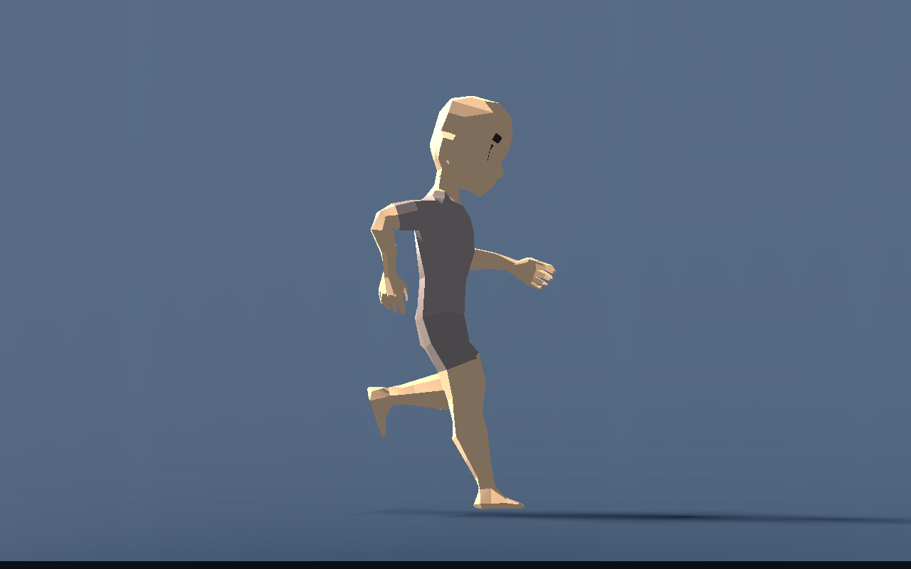
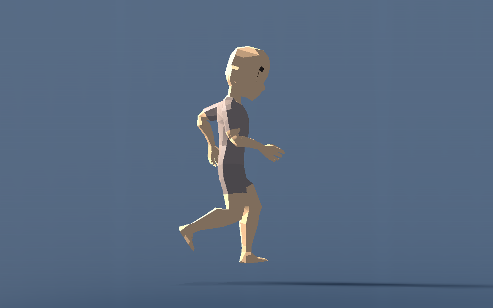

# T-011 — echte motorbeelden, knieën en renderkosten

Gebouwd op geïntegreerde bron `2be5a56`, met de presentatiecorrecties in dezelfde commit als dit verslag. Geen wijzigingen aan capsulebesturing, camera, sprong- of slideregeling. De menselijke beoordeling van de beweging blijft open; negatieve kniefeedback en de daaropvolgende voet-/armfeedback zijn hieronder verwerkt.

## Gebouwd

- Alleen steunvoeten bewaren een wereldpunt. Vrije zwaaivoeten reizen lokaal mee met de capsule en beginnen na een echte voetwissel vanuit hun actuele positie. Voorheen sprong de nieuwe zwaaivoet bij sprintlanding naar een oud afzetpunt, gemeten tot **1,87 m achter het lichaam** bij slechts 0,67 m beenbereik. De IK bereikte zijn afgekapte doel wel, maar de knieën werden zichtbaar gestrekt; de oude bereiktest zag dit niet.
- De achterste sprintzwaai haalt de hiel op, daarna zwaait de knie naar voren en strekt het been naar contact. Rustige passen krijgen minder voetheffing. Het bekken blijft ook bij de afzet binnen het echte beenbereik. De romp leunt nu met het correcte teken vooruit.
- Voeten behouden hun anatomische importrust en natuurlijke teenstand. Enkelpitch volgt de pasfase, met vlakke steun en contactvoorbereiding. Na gebruikersfeedback is de faseuitslag verlaagd van 24° naar **10°**; de vrije voet is bovendien begrensd tegenover het werkelijke onderbeen (20° teenhef, 45° strekking). Een bijna horizontaal onderbeen in hielherstel mag dus een naar beneden gerichte voet hebben, zonder een extreme hoek tussen voet en scheen.
- De handzwaai is **12% armlengte voorwaarts verschoven** (Artemis circa 5,7 cm), na de opmerking dat de armen meer naar voren mochten. Tegenfase en snelheidsafhankelijke elleboogbuiging blijven behouden.
- Physics berekent eenmaal per motorframe de IK-pose. De `SkeletonModifier3D` mengt in renderframes alleen vorige/huidige lokale poses van de aangedreven botten. Grondmetingen blijven op physicsfrequentie, maximaal twee presentatierays per Character per tick.

Veilig instelbaar onder het lichaamsprofiel: `Stance Width Ratio`, `Torso Lean Scale`, `Heel Recovery Ratio`, `Ankle Swing Degrees`, `Arm Forward Ratio` en de twee enkelgrenzen. Deze waarden zijn per instance, worden live gelezen en veranderen de rigidentiteit niet. De twee bestaande curves blijven onafhankelijk bewaard. [Loopreferentie van de gebruiker](../../../source_assets/characters/references/running-poses.png).

## Werkelijke beelden

Alle beelden gebruiken `Character.tscn`, `AtlasCharacterIntent` en echte motorframes. Geen nagebootste contactframes. De detailcamera verbergt alleen andere renderlagen; capsule, skelet en timing blijven hetzelfde.

De twee na arm-/voetfeedback bekeken zijbeelden zijn afzonderlijk bewaard:





De overige beelden in `live-images` tonen rustig lopen, sprintsteun/-vlucht, bewust springen, slide, crouch, lig, voor-/achteraanzicht en de hoofdscene. De hoofdscene is een visuele rookproef, geen prestatievergelijking met de eenvoudige meetvloer.

## Technisch gecontroleerd

`procedural_knee_checks.gd` controleert echte motorpassen op vier lichamen bij 1, 5 en 9 m/s. Het meet **het oorspronkelijke voetdoel**, de werkelijke enkel, knieflexie, knierichting, tegenzwaai van armen, discontinuïteit bij landing en de werkelijke voet-/scheenhoek. Daarmee wordt de eerder gemiste uitrekking zichtbaar. Alle controles slagen:

- Grootste enkelafwijking tegenover ongeclampte doelen circa 0,0000012 m; geen landingssprong van de nieuwe zwaaivoet.
- Artemis knieflexie circa 11–48° bij 1 m/s, 11–85° bij 5 m/s en 11–126° bij 9 m/s. Alle drie andere verhoudingen bewegen met dezelfde planner; sterkste sprintflexie circa 133°.
- Geen verkeerde armtegenfase in de bemonsterde contactvoorbereiding. Vrije enkel blijft binnen de ingestelde anatomische grenzen; geen omgekeerde knierichting.
- `procedural_integration_checks.gd` en `procedural_presentation_checks.gd` slagen. Werkelijke steunvoetafwijking blijft onder een micrometer; geen overreach-loslating bij gewone sprint. Nul-vluchtcurve/plafond behouden hun gesteunde voetwissels en contacten.

De renderinterpolatieproef leest de werkelijk vervormde huidvertices terug, buiten de prestatiemeting. Bij 144 Hz veranderde de oude huid in **0 van 104** renderparen binnen dezelfde physics-tick. Met de posebuffer: **104 van 104**, en 179 poseveranderingen over 180 renderbeelden. Bij 60 Hz eveneens 179/179. Een nieuw renderbeeld krijgt dus een tussenpose, zonder extra physics of IK-zoekwerk. Bron: `skin-interpolation.json`.

## Herhalen

Vanaf de repository, met de afgesproken Godot 4.7.2-consoleversie op PATH:

```powershell
godot --headless --path game --script res://tests/procedural_knee_checks.gd
godot --headless --path game --script res://tests/procedural_integration_checks.gd
godot --headless --path game --script res://tests/procedural_presentation_checks.gd
godot --path game --script res://tests/procedural_live_preview.gd --rendering-method gl_compatibility --rendering-driver opengl3
godot --path game --script res://tests/procedural_interpolation_checks.gd --rendering-method gl_compatibility --rendering-driver opengl3
```

De renderproeven maken een tijdelijk venster en sluiten automatisch. `-- --poses-only` achter de live-preview slaat de prestatiemeting over. Beelden en meetbestanden komen in Godots `user://`-map; de opgenomen bewijsbestanden staan naast dit verslag. Interpolatie vereist een echte renderer, niet `--headless`. De huid-readback veroorzaakt zelf GPU-wachttijd en wordt daarom nooit voor FPS-metingen gebruikt.

## Door de gebruiker beoordeeld / volgende stap

De gebruiker zag incorrecte knieën, vroeg de loopreferentie te benaderen en vroeg daarna armen verder naar voren en mildere voeten. Die correcties bestaan en zijn technisch gecontroleerd. Het team heeft de gecorrigeerde zijbeelden bekeken; **dit is geen nieuwe positieve gebruikersacceptatie**. De gebruiker kan in de gepubliceerde hoofdscene rustig lopen, sprinten, zijdelings kijken en tussen de lichaamsprofielen wisselen. Beoordeel vooral doorlopende kniehef/hielherstel, de hand voor de romp, enkelhoek en overgang naar grondcontact. Verdere stijlwijzigingen volgen concrete feedback.

## Gemeten render- en physicskosten

Windows, Godot 4.7.2, OpenGL Compatibility, NVIDIA RTX 5060 Ti / driver 617.42. Werkelijke wandtijd, VSync uit, geen `--fixed-fps`, physics 60 Hz. Elke groep krijgt 3 s opwarmtijd en circa 4 s meting. Alle acteurs bewegen en gebruiken de definitieve geïnterpoleerde Artemis-presentatie inclusief arm-/enkelcorrecties. De meetvloer is eenvoudig; feedbackaudio staat uit. Dit is geen FPS-belofte voor een volledige wereld, multiplayer of andere pc.

| Bewegende Characters | Renderinterval p50 / p95 / max (ms) | Physics-monitor p50 / p95 / max (ms) | Process-monitor p50 / p95 / max (ms) | Lokale rays per seconde |
|---|---:|---:|---:|---:|
| 1 | 0,555 / 1,077 / 3,404 | 0,828 / 0,885 / 0,885 | 3,261 / 3,328 / 3,328 | 167 |
| 4 | 1,060 / 2,344 / 3,739 | 1,700 / 1,768 / 1,768 | 2,884 / 3,251 / 3,251 | 669 |
| 12 | 2,760 / 6,489 / 10,953 | 4,363 / 5,821 / 6,732 | 4,661 / 5,378 / 5,548 | 2005 |

`frame_ms` zijn individuele gemeten process/renderintervallen. De CPU-kolommen bemonsteren Godots `Performance.TIME_PROCESS` en `TIME_PHYSICS_PROCESS`; dit zijn trager vernieuwde engine-monitorwaarden, geen individuele per-frame CPU-timers. De kolommen zijn niet optelbaar. De rayteller omvat de ene lokale motorprobe en de maximaal twee voetmetingen; er is geen zoekwerk over alle geometrie. Het aantal gemeten rays groeit in deze proef lineair met het aantal Characters.

Een eerdere desktoprun vóór de laatste enkelstijlcorrectie had één renderinterval van **249,547 ms bij één Character** (p95 1,054 ms). De oorzaak is niet vastgesteld; de desktop was niet als benchmarkomgeving geïsoleerd. De definitieve run hierboven herhaalt die piek niet, maar deze korte steekproef bewijst geen afwezigheid van haperingen tijdens langdurig spelen. Ruwe eindwaarden: [live-performance.json](live-performance.json); [knie-/enkelmetingen](knee-metrics.json); [validatie-uitvoer](live-validation.txt).
