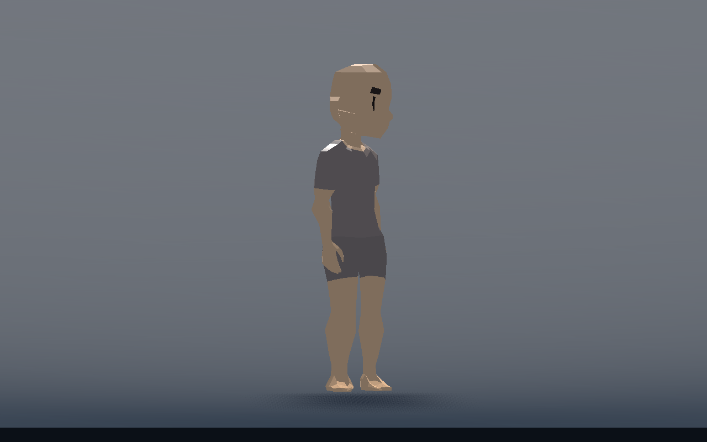

# T-011 — vervolgcorrectie op d1196064

De gebruiker vindt de run goed. Deze ronde verandert de rustige looppas, het stilstaan en de aanloop naar een draaibijstap. De volledige grond-/editoracceptatie blijft open.

- **Gebouwd:** meer borstrotatie vóór de voeten draaien; smallere rust- en loopsporen; vrije zijvoet blijft buiten de steunvoet; kortere eerste gewone steun bij starten, hervatten en omkeren voorkomt de diepe instapdip. De motor blijft de enige eigenaar van capsulepositie en snelheid. Een veilige herstelstap bij stoppen mag de borstreserve niet overslaan.
- **Technisch gecontroleerd:** alle achttien suites en de echte renderer slagen op de gecombineerde bron; zie de eindcontrole hieronder.
- **Door de gebruiker beoordeeld:** run op `d1196064` akkoord; de vier aangeleverde bezwaren zijn gericht gereproduceerd en aangepakt. Deze opvolgende waarden zijn nog niet door de gebruiker gespeeld.
- **Volgende stap:** speel de [korte vervolgproef](ground-trial.md#gerichte-vervolgproef-na-d1196064), met nadruk op stoppen en meteen omkijken, zijwaarts/schuin omkeren en de eerste rustige stap. Pas na voldoende beoordeling volgt de volgende bewegingsproef.

## Afzonderlijk bewijs

[Meer torso vóór bijstappen](torso.md) beschrijft de borstreserve en twee onafhankelijke Inspector-instellingen. [Loopstart en zijstappen](walk-start-side.md) bevat de oorzaken, vóór/na-metingen en echte huidbeelden. Artemis' eerste maximale bekkendaling gaat van 30,02 naar 5,95 cm; de resterende beweging hoort bij de gewone pas. De gebonden contactpunten blijven vast; alleen vrije voeten krijgen een veilige baan. Bij lopen en stoppen gebruikt hetzelfde lichaamsprofiel de smallere voetbreedte.

De nieuwe contactregressie meet daadwerkelijke enkels, knieën en scheensegmenten op vier verschillende lichaamsverhoudingen. Naast vooruit en beide zijrichtingen test hij beide voorwaartse diagonalen en hun omkering, stoppen, nulhoogte en een laag plafond. Zie [diagonale eindcontrole](walk-diagonal-validation.txt). Maximaal twee voetmetingen per physicsframe; geen extra zoeklus of botsimulatie.

De goedgekeurde stabiele voorwaartse sprint is apart vergeleken met de bron van `d1196064`: vier lichamen, 240 opwarmticks, 120 meetframes en 92.640 waarden van capsule, fase, voetdoelen en echte botmatrices. Grootste verschil is 5 × 10⁻¹⁴, dus alleen numerieke afronding. [Referentie-uitvoer](walk-run-reference.txt). Dit is een gerichte vergelijking van die renroute, geen bewijs over alle denkbare bewegingen.

Alle velden blijven vanuit het plaatsbare Character beschikbaar. `Walking Stance Ratio` en `Idle Stance Ratio` zijn standaard 0,50; `Walk Start Support Ratio` is 0,50 voor gewone passen en heeft geen invloed op de sprintcadans. De helper gebruikt voor lage houdingen de eerder afgestemde breedte. Profielkopieën blijven onafhankelijk; deze stijlvelden bouwen de rig niet opnieuw.

## Gecombineerde eindcontrole

Bron `7075dfb`: import, hoofdscene en **alle achttien suites PASS**, inclusief de extra stop-en-kijkregressie en de diagonale contactroutes. [Volledige uitvoer](walk-integrated-validation.txt). Review vond dat neutraal herplaatsen na stoppen de borstreserve kon overslaan; het nieuwe herplaatsdoel houdt de huidige visuele oriëntatie totdat de borst klaar is. Tien echte stop-/kijkroutes hebben nu nul overtredingen. [Vóór/na](stop-turn-validation.txt). Onafhankelijke bronreview vond na deze correctie geen concrete blocker.

Echte D3D12/Forward+ beelden zijn op dezelfde eindcode bekeken. Bij 55 graden blik draait de borst 34,84 graden, terwijl beide voeten en motor-yaw nog op nul blijven. Het beeld hieronder combineert die borstrotatie met de nieuwe smallere ruststand.

Realtime gemeten op de eenvoudige vloer, 1280×800, VSync uit, physics60 en geen andere Godot-proef actief: drie seconden opwarmen en vier seconden meten per aantal Characters. Voor 1/4/12 Characters zijn de renderinterval-p95-waarden **0,853 / 2,323 / 5,818 ms**; maxima **2,691 / 3,820 / 7,116 ms**. Twaalf Characters gebruiken in de meetperiode 8028 grondqueries, circa 2006/s gezamenlijk. De per-tick bovengrens blijft twee voetqueries plus één motorquery. Dit is een lokale korte proef op deze machine, geen FPS-garantie voor een vol level. [Meetgegevens](walk-performance.json) en [rendererlog](walk-render-validation.txt).

Gebruikersbeoordeling van deze WALK-/bijstapcorrectie en de menselijke editorbediening blijft open. De bron wordt als afzonderlijk speelcheckpoint op de werkbranch gepubliceerd; alleen gedeeld geheugen gaat naar main. Geen volgende traversal-, ragdoll- of netwerkfase gestart.
