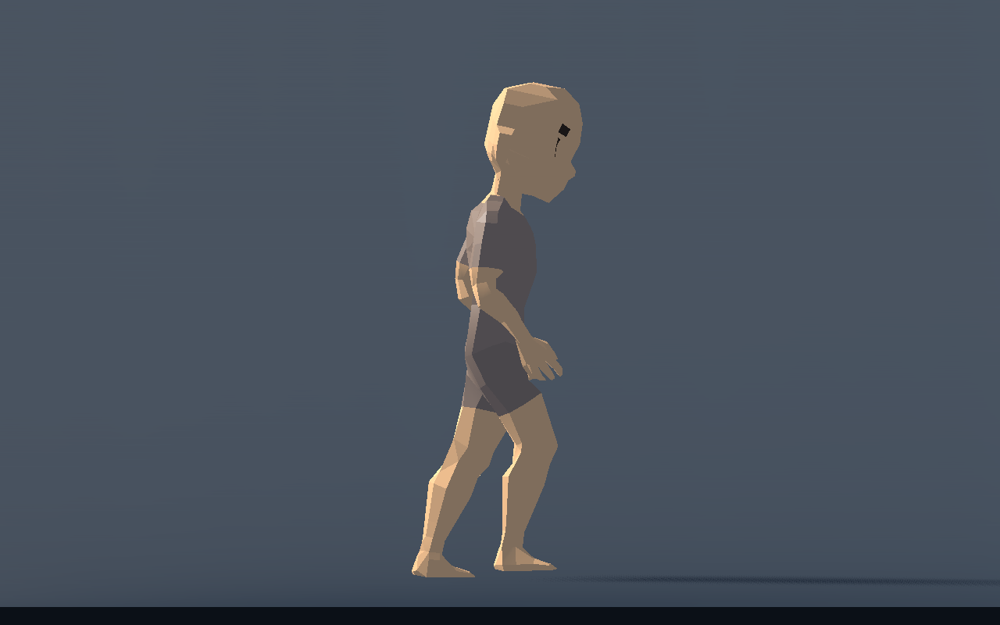
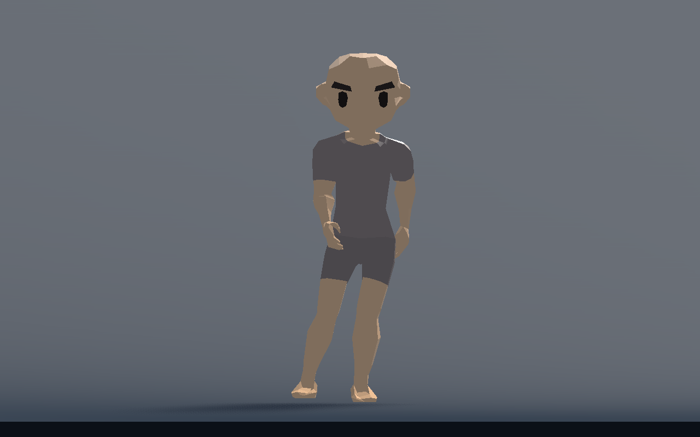
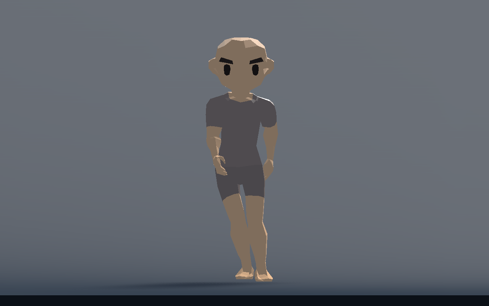
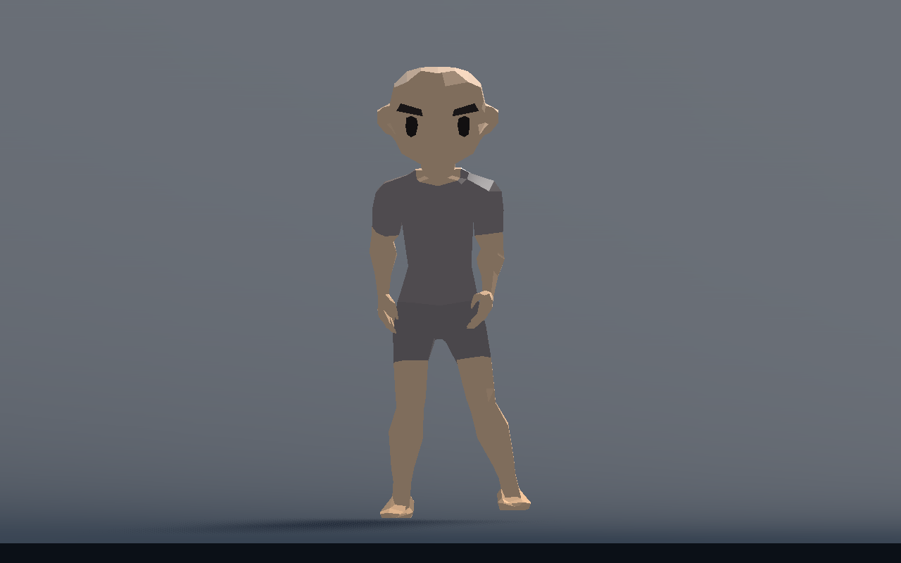
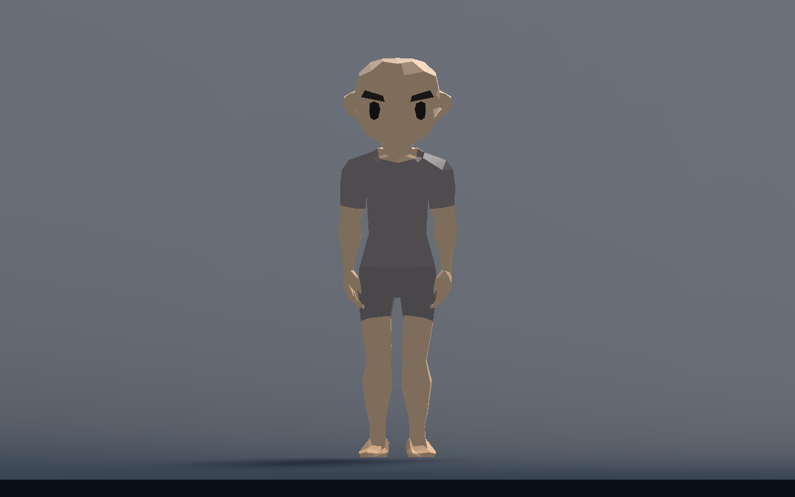

# T-011 — loopstart, zijstappen en smalle stilstand

Gebouwd vanaf `9ca0c5c` (de native bron van de gepubliceerde proef `d1196064`); productie en regressie staan in `884e91a`. De gebruiker vond RUN goed, maar zag kruisende benen bij zijwaarts lopen, een neerwaartse dip bij de eerste gewone pas en te brede WALK-/rustvoeten. Deze correctie richt zich op die drie punten.

## Oorzaak en wijziging

De eerste steunvoet stond nog onder het stilstaande lichaam, terwijl de gewone steunperiode rekende op een al vooruit geplante voet. Daardoor liep de capsule te ver van het contact weg. Artemis zakte tijdens de eerste steun circa 22 cm en vlak na de afzet tot 30 cm; de contactveer was op die frames nog nul. Een kortere eerste gewone steunfase voorkomt dat onbereikbare begincontact. Bij een echte richtingsomkering geldt dezelfde begrensde verkorting, omdat de oude voorste steunvoet dan ineens achter het lichaam staat. Dit komt alleen uit de eigen motorfase en horizontale snelheid; de motor leest geen IK- of renderstaat terug. De volgende afzet of gesteunde voetwissel blijft de bestaande route volgen. Sprint gebruikt factor één.

Zijwaarts herstel gebruikte de voorwaartse hielherstelbaan ook dwars door het andere been. Het dwarsdeel loopt nu langs de toekomstige voetbaan. Een eenvoudige scheiding begeleidt alleen losse voeten buiten de vaste steunvoet. Ook de neutrale bijstap bij stoppen krijgt een veilige bestemming en zwaaibaan wanneer beide voeten tijdelijk naast de capsule staan. Er is geen extra grondzoekwerk of verplaatsing van een wereldpin.

`Walking Stance Ratio` is standaard **0,50**, eerder 0,75. Nieuw `Idle Stance Ratio` is **0,50** en geldt voor initialiseren, stoppen en bijstappen. De bestaande renbreedte blijft 0,65; de eerder beoordeelde lage poses houden hun breedte. `Walk Start Support Ratio` is standaard 0,50 en beschrijft in de Inspector starten, hervatten en omkeren. De instellingen blijven per profiel onafhankelijk en veroorzaken geen rigrebuild.

## Technisch gecontroleerd

De nieuwe `procedural_walk_contacts_checks.gd` meet vanaf de eerste bewegingsframe echte enkel-, knie- en scheenposities op Artemis en drie verschillende boven-/onderbeenverhoudingen. Hij test vooruit, links, rechts, links→rechts, rechts→links, afremmen en rustig herplaatsen naar de smallere stilstand. Hij herhaalt zijwaartse wissels met een nulhoogtecurve en onder een plafond dat de ingestelde boog blokkeert: uitsluitend werkelijk gesteunde stappen, geen fictieve vlucht of zware landingscue.

| Voorwaartse eerste pas | Voorheen: maximale bekkendaling | Nu |
|---|---:|---:|
| Artemis | 30,02 cm | 5,95 cm |
| Evenwichtige proefverhouding | 23,82 cm | 8,60 cm |
| Lange bovenbenen | 30,56 cm | 7,75 cm |
| Lange onderbenen | 25,95 cm | 9,76 cm |

De resterende beweging is de normale pas-/opvanghouding; de eerste pas zakt niet extra diep tegenover de gestage cyclus. Voorheen wisselden de echte enkel- en knievolgorde bij strafing van teken: over vier lichamen tot −51,4 cm bij de enkels en −23,9 cm bij de knieën. Nu blijft de minimale getekende enkelafstand over start, beide omkeringen en stoppen 10,78 cm; knieafstand 13,01 cm en de kortste afstand tussen de twee scheensegmenten 10,30 cm. Dit zijn botmetingen, geen volledige huidbotsingssimulatie.

Maximale echte enkel-doelfout: **1,718 mm**. Voor werkelijk geplante enkels is die fout maximaal **0,000303 mm**; gemeten drift van opeenvolgende vaste wereldcontacten is **0**. Geen noodloslatingen door bereikoverschrijding; maximaal twee voetstralen per tick. Na stoppen is de gemeten Artemis-enkelbreedte 17,81 cm, bij de drie proeflichamen 11,50 cm, overeenkomstig hun eigen rustverhouding.

Acht gerichte suites slagen: loopcontacten, stijl, bijstappen, knieën, motor, terrein, contactloslating en contactveer. Godot 4.7.2, physics60; headless `--fixed-fps 60` versnelt deze logische controles en is geen performancecijfer. De rootintegratie heeft daarnaast de bestaande stabiele RUN-referentie vergeleken: vier lichamen, 240 opwarmticks en 120 meetframes, 92.640 waarden voor capsulepositie/-snelheid, pasfase, voetdoelen en werkelijke botmatrices. Maximale afwijking **5 × 10⁻¹⁴**. RUN blijft daarmee binnen numerieke afronding gelijk.

Compacte gegevens: [vóór/na-metingen](walk-start-side-metrics.json) en [controle-uitvoer](walk-start-side-validation.txt). De actuele volledige meetreeks wordt lokaal naar `user://t011_walk_contacts_metrics.json` geschreven.

## Werkelijke huidbeelden en proef

Deze beelden komen van echte Artemis-motorbeweging met D3D12 Forward+, zonder vervangende poseframes.

Herhalen: `godot --headless --path game --script res://tests/procedural_walk_contacts_checks.gd --fixed-fps 60`. De korte echte huidpreview gebruikt `godot --path game --script res://tests/procedural_walk_contacts_preview.gd`.

Het team heeft de nieuwe huidbeelden gecontroleerd. Menselijke beoordeling blijft open: loop vanuit stilstand, houd A/D vast, keer onderweg om en laat los. Let op de eerste pas, de vrije voet langs de steunvoet en de rustige smallere eindstand. De root voegt dit samen met de afzonderlijke borst-aanloop vóór bijstappen en verzorgt de volledige eindcontrole/publicatie.
